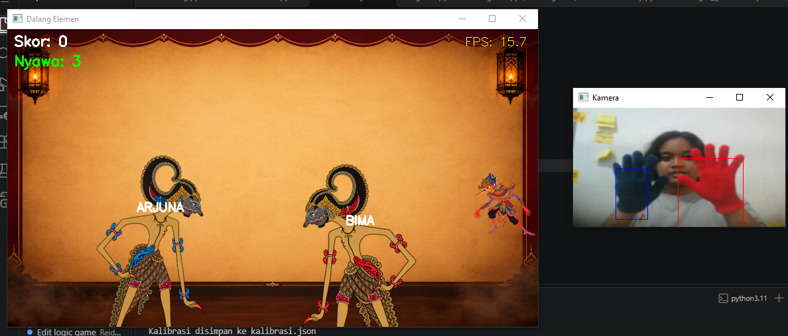
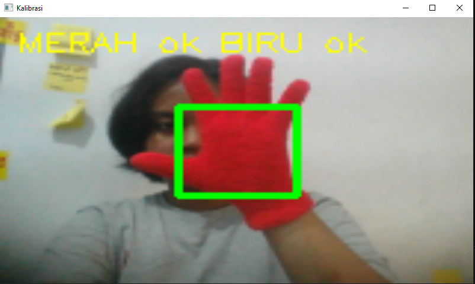
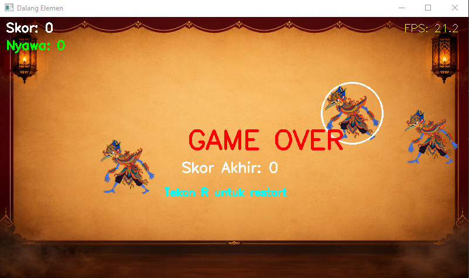

# Dalang Elemen

Dalang Elemen adalah mini game pengolahan citra digital yang mengubah tangan pemain menjadi wayang elemen menggunakan pipeline *computer vision* klasik. Pemain bertindak sebagai dalang yang mengendalikan Bima (Api) dan Arjuna (Air) untuk mengalahkan para Cakil (raksasa) yang menyerang.

Proyek ini dikembangkan sebagai implementasi akhir untuk mata kuliah **Pengolahan Citra dan Video** di Institut Teknologi Sepuluh Nopember (ITS). Seluruh pipeline *computer vision* dibangun dari awal menggunakan operasi matriks NumPy manual, tanpa mengandalkan model *pre-trained* atau *deep learning* (seperti MediaPipe atau YOLO), sesuai dengan kontrak perkuliahan.


*(Catatan: Tangkapan layar belum diunggah. Gambar ini akan menampilkan latar kelir, wayang di tangan pemain, dan animasi musuh Cakil.)*

---

## Tentang Game

Dalam Dalang Elemen, webcam bertindak sebagai "kelir" (layar wayang). Pemain menggunakan sarung tangan merah di tangan kanan dan sarung tangan biru/navy di tangan kiri. Musuh akan muncul dari sisi kanan layar dan bergerak ke kiri. 

Inti dari permainan ini adalah sistem pertarungan lintas elemen:
- Tangan Merah (Api) digunakan untuk mengalahkan Musuh Biru (Air).
- Tangan Biru (Air) digunakan untuk mengalahkan Musuh Merah (Api).

Game ini melacak posisi tangan secara *real-time* menggunakan *thresholding* ruang warna HSV, operasi morfologi untuk membersihkan *noise*, dan *connected components* untuk menghitung *centroid* serta *bounding box* guna mendeteksi tabrakan.

---

## Fitur Utama

- **Pipeline CV Manual (P1-P5):** Pelacakan tangan dilakukan melalui akuisisi webcam (P1), koreksi gamma (P2), konvolusi Gaussian manual (P3), *masking* HSV (P4), dan operasi morfologi (P5).
- **Sistem Pertarungan Lintas Elemen:** Memaksa pemain untuk melakukan pemrosesan visual dan pengambilan keputusan yang cepat, bukan sekadar refleks motorik.
- **Mekanik Dinamis Berbasis Citra:**
  - **Smash:** Mendekatkan tangan ke kamera akan memperbesar luas *bounding box* (P5), memicu serangan dengan *damage* dan radius lebih besar.
  - **Critical Hit:** Gerakan tangan yang cepat (kecepatan perpindahan *centroid* antar-frame tinggi) memberikan *damage* tambahan.
  - **Ultimate (Gunungan):** Menahan kedua tangan dekat ke kamera secara bersamaan akan mengisi daya untuk serangan pembersih layar.
- **Alpha Blending Manual (P4):** Sprite PNG wayang dan musuh dengan transparansi ditempel ke latar belakang menggunakan rumus komposisi piksel manual: $g = \alpha f_{depan} + (1-\alpha) f_{belakang}$.
- **Animasi Sprite 2-Frame:** Musuh memiliki animasi jalan yang diimplementasikan melalui *frame-indexing* berbasis umur entitas.
- **Kalibrasi Interaktif:** Alat kalibrasi HSV bawaan (berbasis *Region of Interest*) memungkinkan game beradaptasi dengan kondisi pencahayaan ruangan dan warna sarung tangan yang berbeda.

---

## Cara Main & Kontrol

### Persiapan
1. Pasang sarung tangan merah di tangan kanan dan biru di tangan kiri.
2. Jalankan alat kalibrasi untuk memetakan warna sarung tangan ke spektrum HSV.
3. Tekan `SPACE` untuk mulai. Kalahkan musuh menggunakan tangan dengan elemen yang tepat.
4. Jangan biarkan musuh lolos ke sisi kiri layar, atau nyawa akan berkurang.

### Kontrol Keyboard

| Tombol | Fungsi |
|---|---|
| `SPACE` | Mulai Game / Jeda (Pause) |
| `R` | Mulai Ulang (Setelah Game Over) |
| `C` | Buka Alat Kalibrasi HSV Interaktif |
| `+` / `-` | Atur Koreksi Gamma (untuk ruangan gelap/terang) |
| `Q` / `ESC` | Keluar dari Game |

---

## Teknologi yang Digunakan

- **Python 3.11**: Bahasa pemrograman utama.
- **NumPy**: Digunakan untuk seluruh operasi tingkat piksel, *slicing* matriks, konvolusi, dan *alpha blending*.
- **OpenCV**: Dibatasi secara ketat hanya untuk I/O (`VideoCapture`, `imread`, `imshow`), konversi ruang warna (`cvtColor`), dan pelabelan `connectedComponents`.
- **Pygame**: Khusus digunakan untuk *mixer* audio (BGM Gamelan dan SFX).

---

## Struktur Proyek

```text
PROJECT-PCV-1/
├── assets/                 # Aset game (Sprite, Audio, Background)
│   ├── backgrounds/        # Gambar kelir (layar wayang)
│   ├── enemies/            # Sprite Cakil (Merah/Biru, animasi 2-frame)
│   ├── sounds/             # BGM Gamelan dan SFX pukulan
│   └── wayang/             # Sprite tangan Bima dan Arjuna
├── src/                    # Modul Computer Vision
│   ├── acquisition.py      # P1: Akuisisi webcam
│   ├── intensity.py        # P2: Transformasi intensitas (Gamma)
│   ├── filtering.py        # P3: Konvolusi spasial manual
│   ├── color.py            # P4: Thresholding HSV & masking
│   ├── morphology.py       # P5: Erosi, dilasi, tracking objek
│   ├── calibration.py      # Alat kalibrasi HSV interaktif
│   ├── overlay.py          # P4: Alpha Blending manual
│   ├── audio.py            # Wrapper audio Pygame
│   └── game.py             # Logika game, entitas, dan tabrakan
├── docs/                   # Dokumentasi media (Screenshot/Video)
├── main.py                 # Game loop utama dan rendering
├── debug_pipeline.py       # Visualisasi tahap pipeline CV
├── requirements.txt        # Dependensi Python
└── README.md               # Dokumentasi proyek

---

## Instalasi dan Persiapan

### Prasyarat
- Python 3.8 atau lebih baru
- Webcam yang berfungsi
- Sarung tangan merah dan biru (navy)

### Langkah Instalasi
1. Clone repositori ini:
   ```bash
   git clone https://github.com/mrvlx/PROJECT-PCV-1.git
   cd PROJECT-PCV-1
   ```
2. Install dependensi yang dibutuhkan:
   ```bash
   pip install -r requirements.txt
   ```
3. **Persiapkan Aset:** Pastikan sprite PNG dan file audio diletakkan di folder yang sesuai di dalam `assets/`. *(Catatan: PNG dengan latar belakang putih akan diproses otomatis untuk menghapus warna putih tersebut melalui thresholding manual di `overlay.py`)*.

---

## Cara Menjalankan

### 1. Kalibrasi Warna (Wajib untuk pertama kali)
Kondisi pencahayaan sangat memengaruhi nilai HSV. Jalankan alat kalibrasi untuk memetakan sarung tangan Anda:
```bash
python -m src.calibration
```
- Arahkan sarung tangan **Merah** ke dalam kotak hijau, lalu tekan `R`.
- Arahkan sarung tangan **Biru** ke dalam kotak hijau, lalu tekan `B`.
- Tekan `S` untuk menyimpan konfigurasi ke `kalibrasi.json`.

### 2. Mulai Permainan
```bash
python main.py
```

### 3. Debugging Pipeline (Opsional)
Untuk melihat visualisasi mentah dari pipeline CV (mask, pembersihan morfologi, kotak tracking) guna keperluan debugging atau laporan akademik:
```bash
python debug_pipeline.py
```

---

## Dokumentasi Visual

*(Bagian ini berisi placeholder untuk media yang akan diunggah ke direktori `docs/`)*

| Alat Kalibrasi HSV | Debugging Pipeline CV | Layar Game Over |
| :---: | :---: | :---: |
|  |  |  |

**Demonstrasi Gameplay:**
[Tonton Video Demo Gameplay](docs/videos/gameplay-demo.mp4) *(Tautan menunggu unggahan video)*

---

## Catatan Pengembangan (Referensi Akademik)

- **Mengapa Tanpa MediaPipe?** Kontrak kuliah (P1) secara ketat melarang penggunaan model *pre-trained* atau *deep learning* untuk paruh pertama semester. Hal ini memaksa implementasi pipeline CV klasik (thresholding HSV + pembersihan morfologi) yang sangat edukatif dan bekerja dengan baik pada pencahayaan terkontrol.
- **Masalah Wrap-Around Warna Merah (P4):** Dalam ruang warna HSV (skala OpenCV 0-179), warna merah terbelah di batas (0-10 dan 170-179). Modul `color.py` menangani ini dengan menghasilkan dua *mask* boolean terpisah dan menggabungkannya dengan operasi logika OR.
- **Pembersihan Morfologi (P5):** *Mask* HSV mentah sangat *noisy* (terdapat *noise salt-and-pepper* dari tekstur kain sarung tangan). Kami menerapkan operasi *Opening* (Erosi dilanjutkan Dilasi) untuk menghilangkan *noise* latar, diikuti dengan *Closing* untuk menutup lubang di dalam *mask* sarung tangan, memastikan *bounding box* yang solid untuk deteksi tabrakan yang akurat.
- **Peningkatan Citra Berwarna (P2 & P4):** Koreksi gamma hanya diterapkan pada kanal V (Value) dari ruang warna HSV, bukan pada kanal RGB secara terpisah. Hal ini menjaga agar informasi Hue (warna asli) tidak bergeser saat menyesuaikan kecerahan.

---

## Keterbatasan yang Diketahui

- **Ketergantungan pada Pencahayaan:** Karena game ini mengandalkan *thresholding* HSV, perubahan drastis pada pencahayaan ruangan atau bayangan tebal pada sarung tangan dapat menyebabkan hilangnya pelacakan. Hal ini dimitigasi oleh alat kalibrasi bawaan (tombol `C`) dan koreksi Gamma.
- **Interferensi Latar Belakang:** Objek besar di dunia nyata yang memiliki profil HSV yang sama persis dengan sarung tangan (misalnya kursi merah terang atau tirai biru) dapat memicu *false positive*.

---

## Kredit

- **Pengembang:** Reidita Eirene ([@mrvlx](https://github.com/mrvlx))
- **Mata Kuliah:** Pengolahan Citra dan Video
- **Dosen Pengampu:** Ir. Arta Kusuma Hernanda, S.T., M.T.
- **Institusi:** Institut Teknologi Sepuluh Nopember (ITS)
- **Aset Budaya:** Konsep Wayang dan Gamelan merupakan bagian dari warisan budaya Indonesia.

---

## Lisensi

Proyek ini dibuat untuk keperluan akademik dan tugas akhir mata kuliah. Belum ada lisensi *open-source* spesifik yang diterapkan pada repositori ini.
